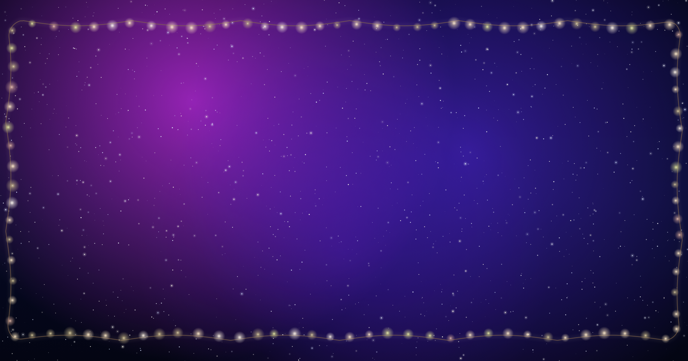

# Snowfall ❄️

Snow on your Mac desktop. A few other things you can switch on too.



Snowfall is a small menu bar app for macOS. Everything it draws goes straight onto
your wallpaper — behind your desktop icons, under the menu bar — so it feels like part
of the desktop and not a window sitting on top of it.

It works on every screen you have plugged in.

## What it does

- **Snow** — falling snow in three depths of storm: *Light*, *Cozy*, *Blizzard*
- **Christmas lights** — a warm string of fairy lights around the edge of the screen
- **Autumn leaves** — maple, oak and amber leaves blowing across the screen
- **Space** — a night sky with stars, nebula clouds and shooting stars

Each effect has its own switch. The ones that need more than on/off (light colour and
brightness, how many leaves, how fast they fall) have sliders in the **Customize**
window, and you can see the changes right away on your desktop.

The app sits in the menu bar, asks for no permissions, and never uses the network.

## Install

Grab the latest `.dmg` from the [Releases](https://github.com/iiiKirusu/snowfall/releases)
page, open it and drag **Snowfall** into your **Applications** folder. Then open it
from Applications.

macOS will most likely tell you it can't verify the app, because it isn't signed with
an Apple Developer certificate. It only happens once:

1. Right-click Snowfall in Applications and choose **Open**, then **Open** again, or
2. Go to **System Settings → Privacy & Security**, scroll down and click
   **Open Anyway** next to Snowfall, or
3. Run this in the Terminal:

   ```bash
   xattr -dr com.apple.quarantine /Applications/Snowfall.app
   ```

## Using it

Open **Snowfall** and a small control panel shows up.

- The big button turns the snow on and off
- **Light / Cozy / Blizzard** sets how hard it snows
- Tick **Christmas Lights**, **Autumn Leaves** or **Space Stars** to add them
- **Customize…** opens the sliders for lights and leaves
- **Hide Window** (or Esc, or the red close button) tucks the panel away

After that the app lives in the menu bar. Click the snowflake icon for the same menu:
turn things on and off, open the panel again, start Snowfall when you log in, or quit.

## Build it yourself

You need macOS 13 or newer and the Xcode Command Line Tools. There are no
dependencies to install — it's plain Swift and AppKit.

```bash
git clone https://github.com/iiiKirusu/snowfall.git
cd snowfall
./Scripts/build-app.sh
```

The app ends up in `dist/Snowfall.app`. To make a disk image as well:

```bash
./Scripts/make-dmg.sh
```

`dist/Snowfall-<version>.dmg` is ready to share.

## How it works

The effects live in a borderless, click-through window that sits just above the
wallpaper window and below the Finder's desktop icons:

| File | What it does |
| --- | --- |
| `Sources/Snowfall/SnowWindow.swift` | The overlay window and its window level |
| `Sources/Snowfall/SnowView.swift` | Two layers of snow particles |
| `Sources/Snowfall/LightsView.swift` | The sagging wire of fairy lights |
| `Sources/Snowfall/LeavesView.swift` | Leaf sprites and the emitter that blows them |
| `Sources/Snowfall/SpaceView.swift` | Starfield, nebula, twinkling stars, shooting stars |
| `Sources/Snowfall/SnowTextures.swift` | Snowflake sprites drawn at runtime |
| `Sources/Snowfall/AtmosphereController.swift` | The sliders for lights and leaves |
| `Sources/Snowfall/CreditsController.swift` | The credits window |
| `Sources/Snowfall/AppDelegate.swift` | Menu bar item, settings, login item |

Sprites are drawn with Core Graphics at runtime, so there are no image files to ship.

## Credits

Made by [iiiKirusu](https://github.com/iiiKirusu) — say hi on
[Instagram](https://instagram.com/kirusuz).

## License

MIT. See [LICENSE](LICENSE).
